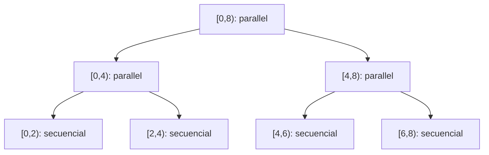

# Informe de proceso

## 1. Un paso de simulación

La función `mover` recibe una partícula y un intervalo de tiempo `dt`. Calcula su nueva posición sumando a la posición actual el producto entre la velocidad y el intervalo de tiempo. Finalmente, construye una partícula nueva que conserva la velocidad y la masa originales.

Por ejemplo, si la posición es $(2,1)$, la velocidad es $(3,-2)$ y $dt=2$, la nueva posición es:

$$
(2,1)+(3,-2)\cdot 2=(8,-3)
$$

La función `pasoSecuencial` avanza todo el sistema mediante una llamada a `pasoSegmento`, utilizando el intervalo completo $[0,n)$, donde $n$ representa el número de partículas.

La función `pasoSegmento` recibe los límites `desde` y `hasta`, toma el subarreglo correspondiente mediante `slice` y aplica `mover` a cada partícula con `map`. El intervalo es semiabierto: incluye el índice inicial y excluye el final. De esta manera, se conserva el orden de las partículas.

### Ejecución paralela

La función `pasoParalelo` divide recursivamente el sistema en dos mitades utilizando `parallel`, siempre que el tamaño del segmento sea superior al umbral. Cuando el segmento alcanza el umbral o tiene como máximo un elemento, se procesa secuencialmente mediante `pasoSegmento`.

Para un sistema de ocho partículas y un umbral de 2, la ejecución sigue esta distribución:

En cada división, el punto medio se calcula mediante:

$$
mitad=desde+\frac{hasta-desde}{2}
$$

Así, cada segmento se divide en dos intervalos:

$$
[desde,mitad)
$$

$$
[mitad,hasta)
$$

Una vez procesadas ambas mitades, sus resultados se combinan mediante `++`, colocando primero el resultado izquierdo y después el derecho. Esto permite conservar el orden original de las partículas.

## 2. Magnitudes del sistema

La función `energiaSecuencial` recorre todas las partículas mediante `foldLeft` y acumula sus energías cinéticas. Para cada partícula se utiliza la expresión:

$$
E_i=\frac{1}{2}m_i(v_{xi}^{2}+v_{yi}^{2})
$$

La energía total corresponde a la suma de las energías individuales:

$$
E_{total}=\sum_{i=1}^{n}E_i
$$

La función `masaTotal` también utiliza `foldLeft` para acumular las masas de todas las partículas:

$$
M=\sum_{i=1}^{n}m_i
$$

Por su parte, `centroDeMasaSecuencial` calcula el centro de masa acumulando en una sola pasada dos valores: la suma de las posiciones ponderadas por sus masas y la masa total.

La expresión matemática es:

$$
CM=\frac{\sum_{i=1}^{n}m_i\vec{x}_i}{\sum_{i=1}^{n}m_i}
$$

La función utiliza una tupla para almacenar ambos acumuladores. Al finalizar el recorrido, divide la posición ponderada entre la masa total. Si la masa acumulada es cero, devuelve el vector de origen $(0,0)$ para evitar una división entre cero.

## 3. Cálculo paralelo de las magnitudes

Las funciones `energiaParalela` y `centroDeMasaParalelo` utilizan la misma estrategia de división por mitades de `pasoParalelo`. Cada segmento se procesa secuencialmente cuando alcanza el umbral; de lo contrario, se divide y sus dos partes se ejecutan mediante `parallel`.

### Energía paralela

La función `energiaParalela` calcula la energía parcial de cada segmento utilizando `foldLeft`. Cuando las dos mitades terminan, sus resultados se combinan mediante una suma:

$$
E_{total}=E_{izquierda}+E_{derecha}
$$

Este procedimiento se repite hasta obtener la energía total del sistema.

### Centro de masa paralelo

Para calcular el centro de masa, cada segmento devuelve una tupla compuesta por:

- La suma de las posiciones ponderadas por sus masas.
- La masa total del segmento.

Cuando se procesan dos mitades, se combinan sus resultados sumando por separado ambos componentes:

$$
(\vec{P},M)=
(\vec{P}_{izq}+\vec{P}_{der},
M_{izq}+M_{der})
$$

Al finalizar la recursión, la llamada inicial obtiene la posición ponderada total y la masa total. Solo entonces realiza la división para calcular el centro de masa.

Este procedimiento es importante porque no se deben promediar directamente los centros de masa de las dos mitades. Si sus masas son diferentes, ese promedio produciría un resultado incorrecto. Por ejemplo, una mitad con masa 10 y otra con masa 1 deben contribuir proporcionalmente a sus respectivas masas.

## 4. Trabajo, profundidad y tiempo estimado

La función `trabajo(n)` representa el trabajo total necesario para procesar un sistema de $n$ partículas. Como se considera una operación por partícula, retorna:

$$
W(n)=n
$$

La función `profundidad(n,umbral)` calcula la profundidad del árbol de divisiones. Si el tamaño del segmento es menor o igual al umbral, retorna el tamaño restante. En caso contrario, divide el segmento en dos mitades y suma una unidad a la mayor profundidad de ambas:

$$
D(n,u)=
\begin{cases}
n, & n\leq u\\
1+\max(D(\lfloor n/2\rfloor,u),
D(\lceil n/2\rceil,u)), & n>u
\end{cases}
$$

Se utiliza el máximo porque las dos mitades se ejecutan concurrentemente y el tiempo de finalización depende de la rama que tarde más.

Por ejemplo, para $n=9$ y umbral $u=4$, la primera división produce segmentos de tamaño 4 y 5. El primero cumple el umbral y tiene profundidad 4. El segundo se divide en segmentos de tamaño 2 y 3; ambos cumplen el umbral y tienen profundidades 2 y 3, respectivamente.

Por tanto:

$$
D(9,4)=1+\max(4,3+1)=5
$$

Finalmente, `tiempoEstimado(n,p,umbral)` combina la profundidad y el trabajo distribuido entre los $p$ procesadores:

$$
T_{estimado}(n,p,u)=D(n,u)+\frac{W(n)}{p}
$$

Esta expresión corresponde al modelo de estimación implementado en el programa. No representa una medición directa en milisegundos, sino una aproximación basada en el trabajo y la profundidad.

## 5. Aceleración y medición

La función `medir` utiliza ScalaMeter para obtener varias mediciones de la ejecución de una función. En cada repetición utiliza `Warmer.Default` para calentar la ejecución antes de medirla. Después ordena las muestras y devuelve la mediana.

En el experimento se utilizan cinco repeticiones:

$$
T_{medido}=\operatorname{mediana}(t_1,t_2,t_3,t_4,t_5)
$$

La función `aceleracion` calcula la relación entre el tiempo secuencial y el tiempo paralelo:

$$
S=\frac{T_{secuencial}}{T_{paralelo}}
$$

Un valor superior a 1 indica que la versión paralela fue más rápida; un valor igual a 1 indica tiempos equivalentes y un valor inferior a 1 significa que la ejecución paralela fue más lenta.

La función `umbralConveniente` recibe una lista de umbrales candidatos, mide el tiempo de ejecución de `pasoParalelo` para cada uno y selecciona el que obtiene el menor tiempo. Si la lista está vacía, devuelve el tamaño del sistema, lo que equivale a procesarlo sin dividirlo en tareas paralelas.

## 6. Experimento de medición con App.scala

La aplicación `App.scala` realiza un experimento para comparar el rendimiento secuencial y paralelo de la simulación.

Se establecen los siguientes parámetros:

- Intervalo de tiempo: $dt=0.01$.
- Número de repeticiones: 5.
- Número de procesadores: obtenido mediante `Runtime.getRuntime.availableProcessors()`.
- Tamaños de los sistemas: 1.000.000 y 2.000.000 de partículas.

Para cada tamaño se construye un sistema de partículas mediante `Array.tabulate`. Las posiciones se generan utilizando el índice de cada partícula, las velocidades se inicializan en $(1.0,0.5)$ y todas las masas tienen valor 1.0.

Primero se mide la ejecución secuencial con `pasoSecuencial`. Después se construye la lista de umbrales candidatos:

$$
U=\operatorname{distinct}
\left(
\operatorname{sorted}
\left(
[1024,n/16,n/4,n]
\right)
\right)
$$

Para cada umbral se ejecuta `pasoParalelo` y se calculan dos indicadores.

**Aceleración medida:**

$$
S_{medida}=
\frac{T_{secuencial}}{T_{paralelo}}
$$

**Aceleración estimada:**

$$
S_{estimada}=
\frac{W(n)}{T_{estimado}(n,p,u)}
$$

La aceleración medida utiliza los tiempos obtenidos experimentalmente, mientras que la aceleración estimada utiliza el modelo de trabajo y profundidad desarrollado en el punto 4.

El umbral igual al tamaño del sistema, $u=n$, funciona como control. En ese caso, la condición base de `pasoParalelo` se cumple desde la primera llamada y se procesa el intervalo completo mediante `pasoSegmento`, sin crear divisiones ni ejecutar tareas paralelas. Su procesamiento es equivalente al de `pasoSecuencial`.

Finalmente, la aplicación imprime una tabla con el tamaño del sistema, el umbral utilizado, el tiempo secuencial, el tiempo paralelo, la aceleración medida y la aceleración estimada. Esto permite comparar los diferentes tamaños y configuraciones de ejecución.

## 7. Conclusión

La implementación utiliza una estrategia de división y combinación para distribuir el procesamiento de partículas entre varios núcleos. Los segmentos se dividen recursivamente en dos mitades, se procesan concurrentemente mediante `parallel` y se combinan conservando el orden o la operación matemática correspondiente.

Las magnitudes globales se calculan mediante acumulaciones parciales, mientras que el modelo de trabajo y profundidad permite estimar el comportamiento de la ejecución paralela.

Por último, el experimento de `App.scala` permite contrastar las estimaciones teóricas con los tiempos medidos para distintos tamaños de sistemas y umbrales, proporcionando información para analizar el efecto de la granularidad en el rendimiento de la simulación.