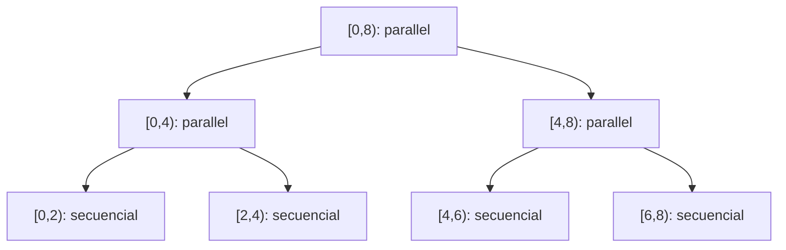

# Informe de proceso

## Un paso de simulacion

`mover` recibe una particula y calcula `pos + vel * dt`. Construye una
particula nueva con esa posicion y conserva velocidad y masa. Por ejemplo, si
la posicion es $(2,1)$, la velocidad es $(3,-2)$ y $dt=2$, la nueva posicion
es $(8,-3)$.

`pasoSecuencial` llama a `pasoSegmento` para el intervalo completo
$[0,n)$. `pasoSegmento` toma el subarreglo indicado y aplica `mover` en el
mismo orden; el limite inicial se incluye y el final se excluye.

Para un sistema de ocho particulas y umbral 2, `pasoParalelo` sigue este arbol.
Cada llamada resuelve dos mitades con `parallel`; los tramos de hasta dos
elementos llegan a `pasoSegmento`. Al terminar, concatena primero el resultado
izquierdo y luego el derecho.

En cada particion el punto medio es `desde + (hasta - desde) / 2`. Asi, las
mitades son $[desde,mitad)$ y $[mitad,hasta)$.

## Magnitudes del sistema

`energiaSecuencial` recorre las particulas y suma
$\frac{1}{2}m(v_x^2+v_y^2)$. `masaTotal` suma sus masas. `centroDeMasaSecuencial`
acumula en una pasada la suma ponderada
$\sum_i m_i(x_i,y_i)$ y la masa $\sum_i m_i$; divide una sola vez al final.
Si la masa acumulada es cero, devuelve el origen.

Las versiones paralelas aplican la misma division por mitades. La energia
combina los subtotales sumandolos. Para el centro, cada tramo devuelve el par
`(suma de posiciones ponderadas, masa total)`. `parallel` obtiene ambos pares;
se suman sus dos componentes y solo en la llamada inicial se hace la division.
Por ejemplo, una mitad de masa 10 y otra de masa 1 no se deben combinar
promediando sus dos centros con el mismo peso.

## Trabajo, profundidad y tiempo estimado

`trabajo(n)` retorna $n$, una operacion por particula. `profundidad` compara el
tamaño con el umbral: si no lo supera, retorna el tamaño restante; en caso
contrario, cuenta una particion y suma la mayor profundidad de las dos mitades.
Se usa la mayor porque las mitades se ejecutan concurrentemente. Con $n=9$ y
umbral 4, la particion produce tramos de 4 y 5; el tramo de 5 se vuelve a
partir, asi que la profundidad es $1+(1+3)=5$. `tiempoEstimado` suma esa
profundidad y el trabajo dividido entre el numero de procesadores.

## Aceleracion y medicion

`aceleracion` divide el tiempo secuencial entre el paralelo. `umbralConveniente`
mide cada candidato con `medir`, que usa ScalaMeter y retorna la mediana de
cinco mediciones calentadas; devuelve el candidato con menor tiempo. Si no hay
candidatos, retorna el tamaño del sistema, que hace que `pasoParalelo` use la
ruta secuencial.

`App.scala` construye los sistemas de prueba, mide la version secuencial y
varios umbrales de la paralela para cada tamaño, e imprime tiempos, aceleracion
y aceleracion estimada. El umbral igual al tamaño es el control: ambas rutas
ejecutan `pasoSecuencial` sobre el mismo sistema y con la misma funcion de
transformacion.
